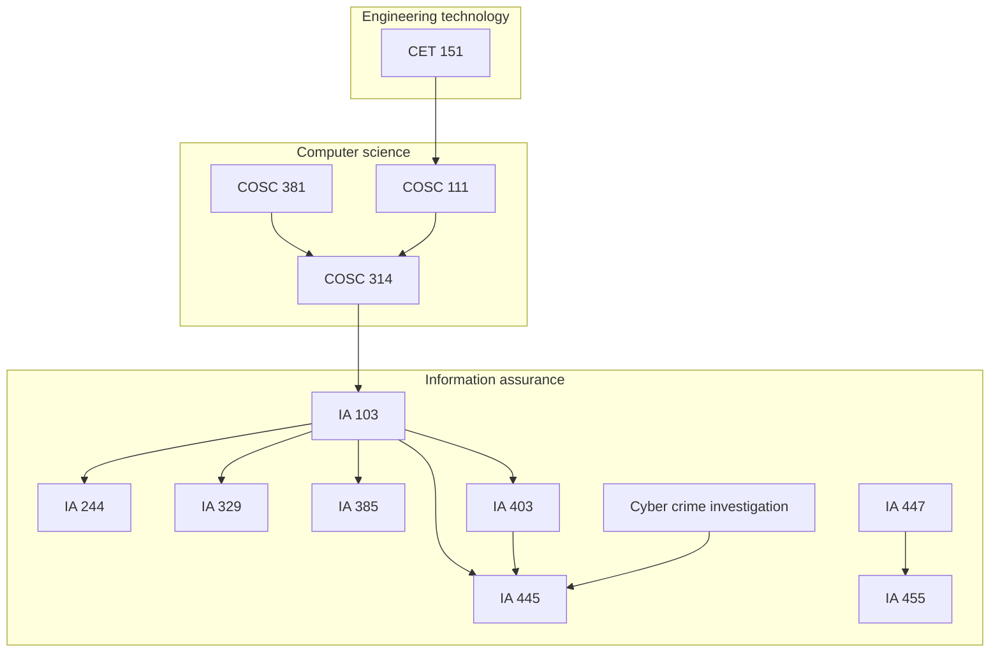

# College Projects — Eastern Michigan University

Index of **undergraduate coursework** repositories (computer science, engineering technology, and information assurance, ≈2022–2024).  
Each course is a **separate GitHub repo** with its own README, docs, and Canvas exports in `archive/`.

**Author:** [Julio Barros](https://github.com/Jkbarros)

## Repositories

| Course | Repository | Focus |
|--------|------------|--------|
| **CET 151** — Intro to Computing in Engineering Technology | [cet-151-intro-computing-engineering-tech](https://github.com/Jkbarros/cet-151-intro-computing-engineering-tech) | MATLAB, Excel, C++ unit projects |
| **COSC 111** — Programming & Data Structures | [programming-data-structures-cosc111](https://github.com/Jkbarros/programming-data-structures-cosc111) | Java OOP labs: hash tables, inheritance, polymorphism |
| **COSC 381** — Software Engineering Solutions | [software-engineering-solutions](https://github.com/Jkbarros/software-engineering-solutions) | Git, Linux shell, class exercises, AWS Academy |
| **COSC 314** — Computational Discrete Structures | [computational-discrete-structures](https://github.com/Jkbarros/computational-discrete-structures) | Relations on matrices; Dijkstra shortest paths (Java) |
| **IA 103** — Information Security Overview | [information-security-overview](https://github.com/Jkbarros/information-security-overview) | Risk analysis, crypto labs, malware case studies, threat intel |
| **IA 244** — Administration of Computer Systems | [ia244-administration-computer-systems](https://github.com/Jkbarros/ia244-administration-computer-systems) | Systems administration labs and midterms |
| **IA 329** — Policy Development for Information Assurance | [ia329-policy-development-info-assurance](https://github.com/Jkbarros/ia329-policy-development-info-assurance) | Policy drafts, DR planning, annotated bibliographies |
| **IA 385** — Database & Web Application Security | [ia385-database-web-application-security](https://github.com/Jkbarros/ia385-database-web-application-security) | Oracle/SQL labs, web application security assignments |
| **IA 403** — Malware Analysis & Reverse Engineering | [ia403-malware-analysis-reverse-engineering](https://github.com/Jkbarros/ia403-malware-analysis-reverse-engineering) | RE labs, malware sample analysis, final report |
| **IA 445** — Ethical Hacking & Offensive Security | [ia445-ethical-hacking-offensive-security](https://github.com/Jkbarros/ia445-ethical-hacking-offensive-security) | Offensive security modules, mobile/IoT/OT labs |
| **IA 447** — Digital Forensics I | [ia447-digital-forensics-i](https://github.com/Jkbarros/ia447-digital-forensics-i) | Forensic cases, steganography, email/memory investigations |
| **IA 455** — Incident Response | [incident-response-ia455](https://github.com/Jkbarros/incident-response-ia455) | Labs, quizzes, memory forensics, course assessments |
| **Cyber Crime Investigation** | [cyber-crime-investigation-emu](https://github.com/Jkbarros/cyber-crime-investigation-emu) | PlayStation Network breach milestones and final analysis |

### Start here

- **Best showcase:** [information-security-overview](https://github.com/Jkbarros/information-security-overview) — markdown labs + runnable `hashcheck.py`.
- **Algorithms:** [computational-discrete-structures](https://github.com/Jkbarros/computational-discrete-structures) · [programming-data-structures-cosc111](https://github.com/Jkbarros/programming-data-structures-cosc111) — Java projects and labs.
- **Forensics & IR:** [ia447-digital-forensics-i](https://github.com/Jkbarros/ia447-digital-forensics-i) · [incident-response-ia455](https://github.com/Jkbarros/incident-response-ia455).
- **Foundations:** [software-engineering-solutions](https://github.com/Jkbarros/software-engineering-solutions) · [cet-151-intro-computing-engineering-tech](https://github.com/Jkbarros/cet-151-intro-computing-engineering-tech).

## Curriculum map

## Layout (every course repo)

| Path | Purpose |
|------|-------------|
| `README.md` | What the course covered and how to explore the repo |
| `docs/` | Readable notes and screenshots |
| `scripts/` | Small utilities when they add value (not every course) |
| `archive/` | Original PDF/DOCX submissions from Canvas |

## Notes for readers

- These repos document **my submitted work** and learning notes; they are not production software.
- EMU or publisher course materials are not redistributed beyond my own submissions in `archive/`.
- Security-related screenshots and scan results are **point-in-time**.

## License

Content © Julio Barros. Code in sub-repositories is provided for demonstration; use at your own risk.
