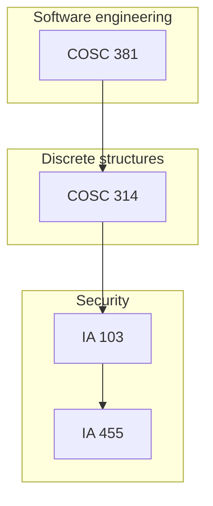

# College Projects — Eastern Michigan University

Index of **undergraduate coursework** repositories (computer science and information assurance, ≈2022–2023).  
Each course is a **separate GitHub repo** with its own README, docs, and Canvas exports in `archive/`.

**Author:** [Julio Barros](https://github.com/Jkbarros)

## Repositories

| Course | Repository | Focus |
|--------|------------|--------|
| **COSC 381** — Software Engineering Solutions | [software-engineering-solutions](https://github.com/Jkbarros/software-engineering-solutions) | Git, Linux shell, class exercises, AWS Academy |
| **COSC 314** — Computational Discrete Structures | [computational-discrete-structures](https://github.com/Jkbarros/computational-discrete-structures) | Relations on matrices; Dijkstra shortest paths (Java) |
| **IA 103** — Information Security Overview | [information-security-overview](https://github.com/Jkbarros/information-security-overview) | Risk analysis, crypto labs, malware case studies, threat intel |
| **IA 455** — Incident Response | [incident-response-ia455](https://github.com/Jkbarros/incident-response-ia455) | Labs, quizzes, memory forensics, course assessments |

### Start here

- **Best showcase:** [information-security-overview](https://github.com/Jkbarros/information-security-overview) — markdown labs + runnable `hashcheck.py`.
- **Algorithms:** [computational-discrete-structures](https://github.com/Jkbarros/computational-discrete-structures) — BlueJ/Java projects.
- **Foundations:** [software-engineering-solutions](https://github.com/Jkbarros/software-engineering-solutions) — tooling and process notes from SE coursework.

## Curriculum map

## Layout (every course repo)

| Path | Purpose |
|------|---------|
| `README.md` | What the course covered and how to explore the repo |
| `docs/` | Readable notes and screenshots |
| `scripts/` | Small utilities when they add value (not every course) |
| `archive/` | Original PDF/DOCX submissions from Canvas |

## Notes for readers

- These repos document **my submitted work** and learning notes; they are not production software.
- EMU or publisher course materials are not redistributed beyond my own submissions in `archive/`.
- Security-related screenshots and scan results are **point-in-time**.

## License

Content © Julio Barros. Code in sub-repositories is provided for demonstration; use at your own risk.
